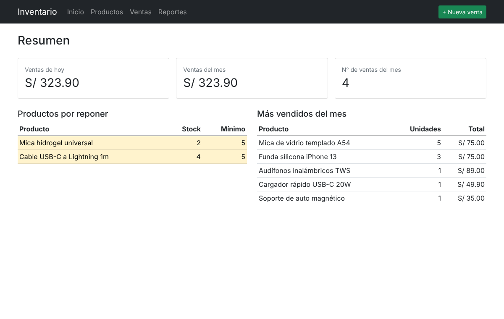
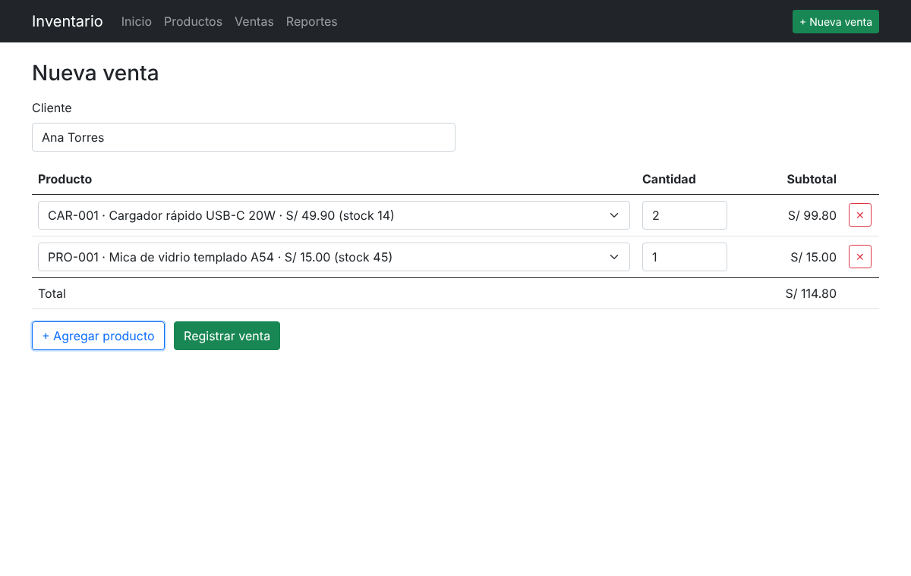
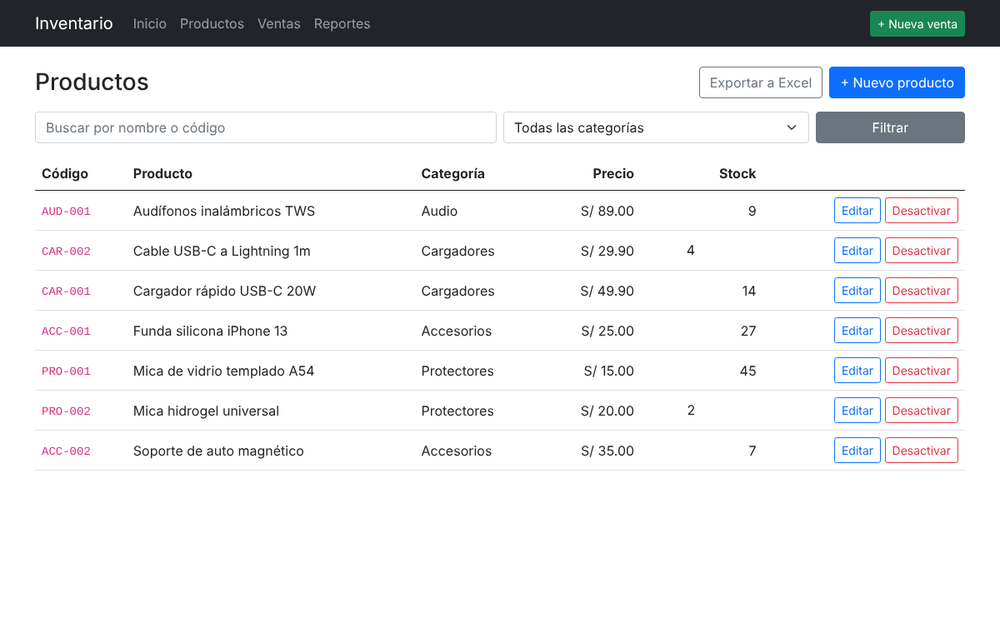
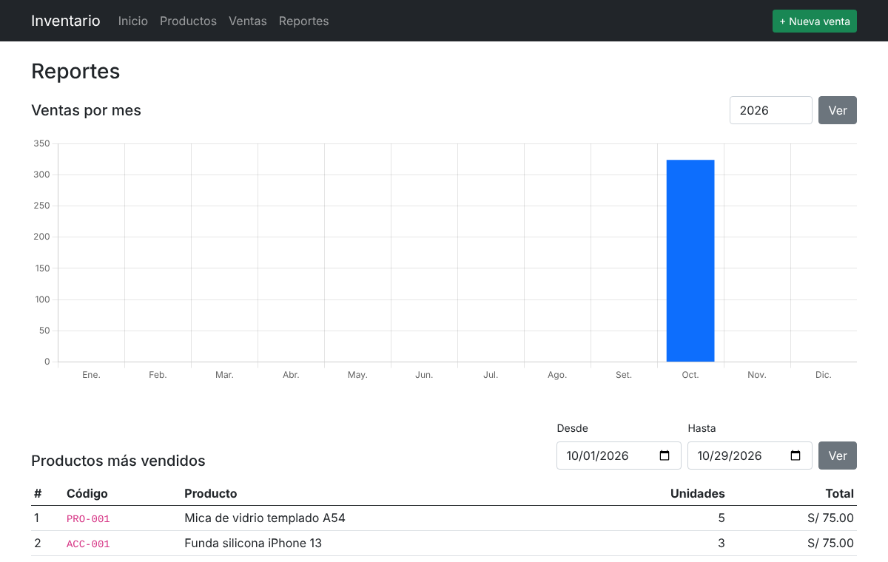

# Inventario y Ventas · ASP.NET Core MVC + SQL Server

Aplicación web para una tienda de accesorios de celulares: catálogo de productos, control de stock,
registro de ventas, anulaciones y reportes. Toda la lógica de datos vive en **procedimientos almacenados
de SQL Server** y la aplicación los llama con **Dapper**.

**Stack:** C# 12 · ASP.NET Core 8 MVC (Razor) · SQL Server · T-SQL (procedimientos, transacciones, TVP) · Dapper · Bootstrap 5 · Chart.js · ClosedXML (Excel) · xUnit · Docker · GitHub Actions

| Inicio | Nueva venta |
|---|---|
|  |  |
| **Productos** | **Reportes** |
|  |  |

## Funcionalidades

- **Productos:** registro y edición con validaciones, búsqueda por nombre o código, filtro por categoría,
  alerta de stock mínimo y exportación del inventario valorizado a **Excel**.
- **Ventas:** formulario con varias líneas y total en vivo. La venta completa se envía a SQL Server en una sola llamada.
- **Anulación:** una venta anulada devuelve las unidades al stock y queda tachada en el historial (no se borra).
- **Reportes:** ventas por mes (gráfico) y productos más vendidos por rango de fechas.
- **Inicio:** ventas del día y del mes, productos por reponer y más vendidos.

## Base de datos

Los scripts están en [`database/`](database) y la aplicación los ejecuta al iniciar en desarrollo:

| Script | Contenido |
|---|---|
| `01_esquema.sql` | Tablas con `PRIMARY KEY`, `FOREIGN KEY`, `UNIQUE`, `CHECK (Stock >= 0)`, columna calculada `Subtotal` e índices |
| `02_procedimientos.sql` | 12 procedimientos almacenados (`usp_Producto_*`, `usp_Venta_*`, `usp_Reporte_*`) |
| `03_datos_iniciales.sql` | Categorías y productos de ejemplo |

Puntos destacados de `usp_Venta_Registrar`:

- Recibe el detalle como **table-valued parameter** (`dbo.TipoDetalleVenta`), así una venta es una sola llamada.
- Corre dentro de una **transacción** con `XACT_ABORT`: si un producto no tiene stock, no se guarda nada.
- Bloquea las filas de los productos con `UPDLOCK` para que **dos ventas simultáneas no vendan el mismo stock**
  (hay una prueba que lanza 10 ventas en paralelo sobre 5 unidades).
- Usa el precio actual del producto, no el que envía el navegador.
- Los errores de negocio se lanzan con `THROW 50001-50099` y la aplicación los muestra como mensajes de validación.

`usp_Venta_Obtener` devuelve cabecera y detalle en dos resultados que se leen con `QueryMultiple`.

## Cómo ejecutarlo

### Opción 1: Docker

```bash
docker compose up --build
```

Abre http://localhost:8081. La base de datos se crea sola con datos de ejemplo.

### Opción 2: Visual Studio + LocalDB

1. Abre `InventarioMvc.sln` en Visual Studio 2022.
2. La cadena de conexión por defecto apunta a `(localdb)\MSSQLLocalDB`; al ejecutar en modo desarrollo se crea la base `Inventario`.
3. Ejecuta con F5.

## Pruebas

Las pruebas de integración crean una base de datos temporal en SQL Server, ejecutan los mismos scripts y la eliminan al final.

```bash
docker compose up -d sqlserver
dotnet test
```

Cubren: alta y edición de productos, código duplicado, venta con varias líneas, rollback por falta de stock,
productos desactivados, anulación, **ventas concurrentes** y reportes. En GitHub Actions corren contra un
contenedor de SQL Server.

## Estructura

```
database/                 Scripts T-SQL (esquema, procedimientos, datos)
src/InventarioMvc.Web
├── Controllers/          Home, Productos, Ventas, Reportes
├── Data/                 Repositorios con Dapper, inicializador de BD, exportación a Excel
├── Models/               Modelos y view models con validaciones
└── Views/                Vistas Razor con Bootstrap
tests/InventarioMvc.Tests Pruebas de integración contra SQL Server
```
