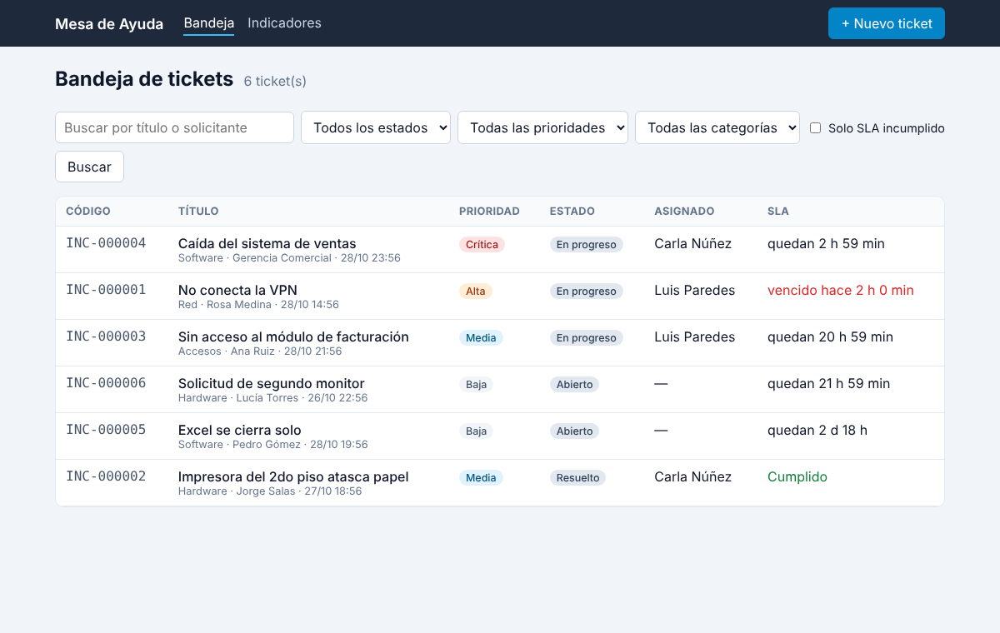
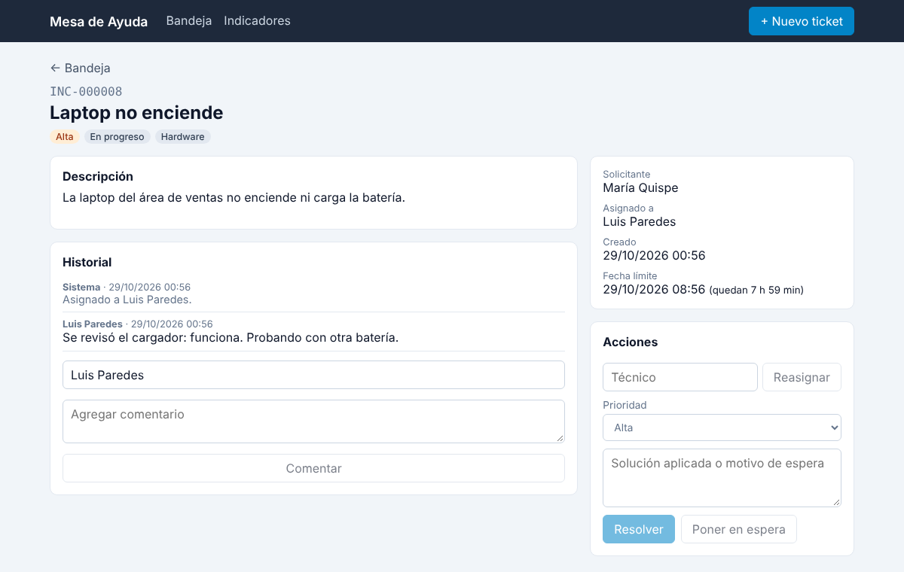
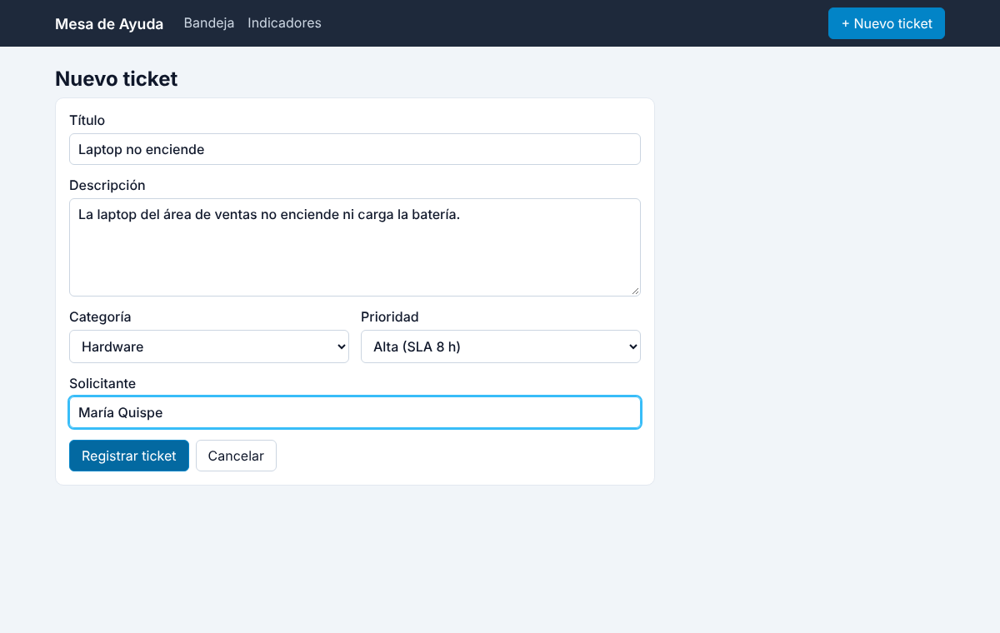
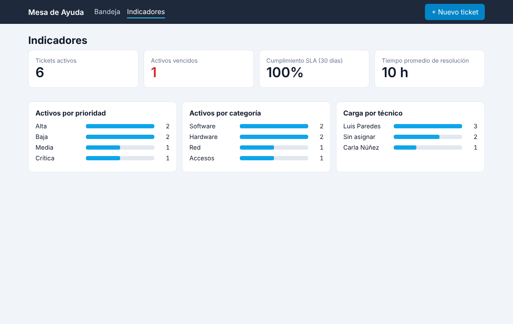

# Mesa de Ayuda · Tickets con SLA (.NET 8 + Angular)

Sistema de mesa de ayuda (service desk) para registrar incidencias de TI, asignarlas a técnicos y controlar
el **tiempo de atención (SLA)** según la prioridad. Backend en **ASP.NET Core** con arquitectura en capas
(Clean Architecture) y frontend en **Angular**.

**Stack:** C# 12 · ASP.NET Core 8 Web API · Clean Architecture · Entity Framework Core 8 · SQL Server · FluentValidation ·
BackgroundService · xUnit · Angular 18 (standalone, signals, formularios reactivos) · TypeScript · Docker · Nginx · GitHub Actions

| Bandeja | Detalle del ticket |
|---|---|
|  |  |
| **Nuevo ticket** | **Indicadores** |
|  |  |

## Qué hace

- **Bandeja priorizada:** los tickets activos aparecen primero, ordenados por prioridad y por la fecha límite más cercana.
  Filtros por estado, prioridad, categoría, texto y "solo SLA incumplido", con paginación.
- **SLA por prioridad:** Crítica 4 h · Alta 8 h · Media 24 h · Baja 72 h. Si se cambia la prioridad, la fecha límite se recalcula.
- **Flujo de atención:** `Abierto → En progreso → (En espera) → Resuelto → Cerrado`, con reapertura si el usuario no está conforme.
  Cada cambio queda en el historial del ticket.
- **Monitor de SLA:** un `BackgroundService` revisa cada minuto los tickets activos y marca los que vencieron.
- **Indicadores:** tickets activos y vencidos, % de cumplimiento de SLA y tiempo promedio de resolución de los últimos
  30 días, y carga por prioridad, categoría y técnico.

## Arquitectura

```
backend/src
├── MesaAyuda.Domain           Entidad Ticket con sus reglas (no depende de nada)
├── MesaAyuda.Application      Casos de uso (TicketService), DTOs, validaciones con FluentValidation,
│                              interfaz ITicketRepositorio
├── MesaAyuda.Infrastructure   EF Core + SQL Server: DbContext, migraciones, repositorio
└── MesaAyuda.Api              Controladores REST, manejo de errores, monitor de SLA, Swagger
frontend/                      Angular 18
```

Las dependencias apuntan hacia adentro: `Api → Infrastructure → Application → Domain`.

- **Modelo de dominio rico:** las reglas (qué transición es válida, cuándo se incumple el SLA) están en la clase `Ticket`,
  con setters privados. Ningún controlador puede dejar un ticket en un estado inválido.
- **Errores con significado HTTP:** validación → `400` con el detalle por campo, regla de negocio → `409`,
  no encontrado → `404`, siempre en formato `ProblemDetails`.
- **Fechas en UTC** en la base de datos; Angular las muestra en la hora local del usuario.
- **Reloj inyectable** (`TimeProvider`): las pruebas adelantan el tiempo para verificar el SLA sin esperar horas.

## Cómo ejecutarlo

### Opción 1: Docker (todo incluido)

```bash
docker compose up --build
```

- Frontend: http://localhost:4200
- Swagger: http://localhost:5030/swagger

La base se crea con migraciones y se cargan tickets de ejemplo.

### Opción 2: Desarrollo local

```bash
# Backend (usa LocalDB por defecto; en desarrollo migra y carga datos de ejemplo)
cd backend
dotnet run --project src/MesaAyuda.Api --urls http://localhost:5030

# Frontend
cd frontend
npm install
npm start
```

## Pruebas

```bash
cd backend
dotnet test
```

19 pruebas: reglas del dominio (SLA por prioridad, transiciones, reapertura, cierre) y pruebas de integración
de la API completa con `WebApplicationFactory` y SQLite en memoria (validaciones 400, reglas 409, flujo de atención,
monitor de SLA con reloj simulado y orden de la bandeja).
